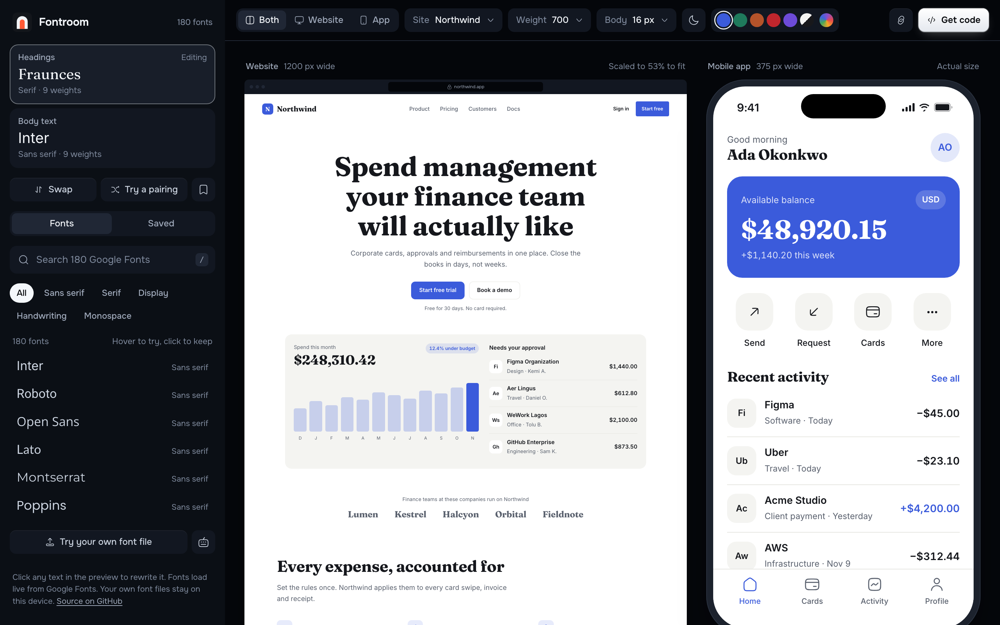
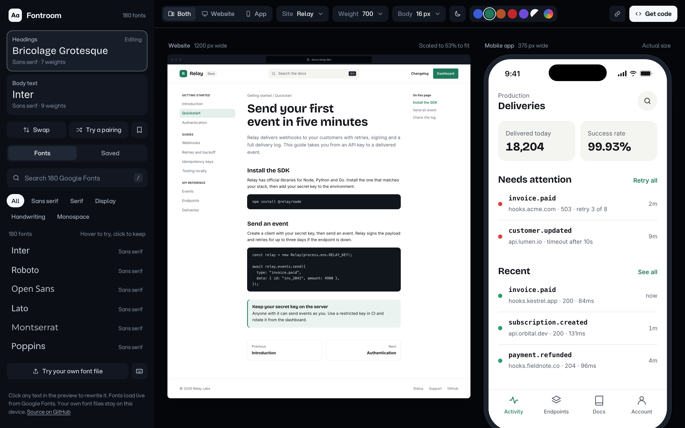
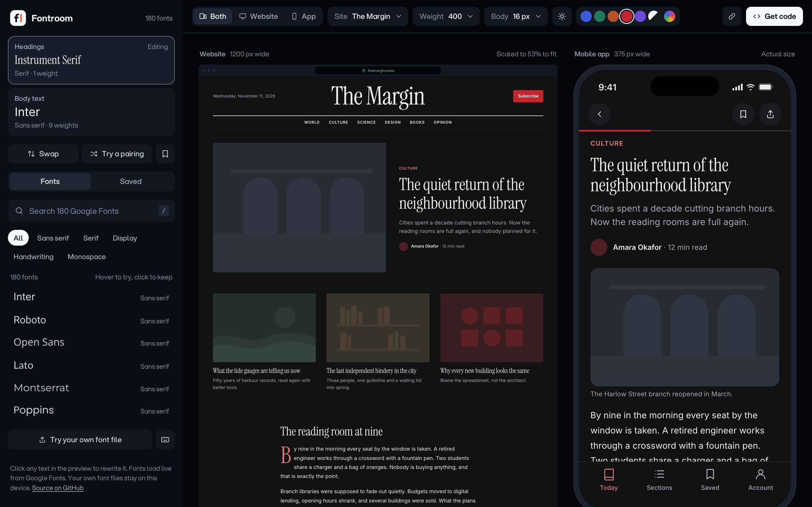

# Fontroom

See your font on a real website and mobile app before you write any code.

Google Fonts shows you one sample sentence. Fontroom puts the font on a full landing page and a phone app, at real sizes, so you can judge headings, body text, buttons and numbers together. When you like the pairing, it gives you the setup code for your stack.

**Live:** [fontroom.vercel.app](https://fontroom.vercel.app)



## Features

- **Live preview on real layouts.** A website and a mobile app side by side, in four styles: a SaaS product, a café, a magazine and a developer docs site.
- **Hover to try, click to keep.** Hover any font in the list, or use the arrow keys, to preview it instantly. Press Enter or click to keep it.
- **180 curated Google Fonts, plus the rest.** Filter by style, or type the exact name of any family on Google Fonts and load it.
- **Your own font files.** Drop a `.woff2`, `.woff`, `.ttf` or `.otf` onto the page to test a brand or paid font. Fontroom reads the file in your browser and never uploads it. It detects variable fonts and the weight of static ones.
- **Heading and body pairing.** Set each font separately, swap them, or try a random pairing from a hand-picked list.
- **Real weights only.** The weight menu shows what the font actually has, so you never design with a weight that doesn't exist.
- **Saved pairings.** Bookmark pairings you like. They stay in your browser.
- **Theme, accent and size.** Switch the preview between light and dark, pick an accent colour or your own, and set the body size.
- **Edit the copy.** Click any text in the preview and type your own words.
- **Copy the code.** Setup code for HTML + CSS, Tailwind v4, Next.js (`next/font`), Flutter (`google_fonts`) and Expo, with only the weights you use. Own font files get `@font-face` and `next/font/local` setup instead.
- **Share links.** The URL holds the whole setup, so a link opens exactly what you see.
- **Keyboard first.** Press `?` in the app for every shortcut.

| Developer docs template | Magazine template, dark preview |
| --- | --- |
|  |  |

## Keyboard shortcuts

| Key | Action |
| --- | --- |
| `/` | Search fonts |
| `↑` `↓`, `Enter` | Preview fonts in the list, keep one |
| `H` / `B` | Edit headings or body text |
| `X` | Swap heading and body fonts |
| `R` | Try a random pairing |
| `S` | Save or unsave the pairing |
| `D` | Light or dark preview |
| `1` `2` `3` | Show both, website or app |
| `U` | Try your own font file |
| `C` | Get the code |
| `?` | Show all shortcuts |

## Run it locally

Fontroom is plain HTML, CSS and JavaScript. There is no build step.

```bash
git clone https://github.com/Tekcify/fontroom.git
cd fontroom
npm install
npm run dev
```

Then open http://localhost:4815. Any static server pointed at `public/` works too.

## Tests

```bash
npm run check
npm test
```

The tests use Node's built-in test runner and jsdom. They cover the font catalogue, weight detection, font file parsing, code generation for every platform, and the main flows in the app: search and preview, templates, share links, saved pairings, custom colours, keyboard shortcuts and own font files.

## Project structure

```
public/
  index.html        Landing page
  app.html          The tool
  primitives.html   Design tokens and components used by the tool
  slop.html         The "before" version, see below
  slop-app.html
  css/app.css       Tool styles, including the preview templates
  css/home.css      Landing page styles
  js/core.js        Font catalogue, weight helpers, font file parsing, code output
  js/templates.js   Website and app templates
  js/app.js         UI and state
  js/home.js        Landing page: font picker, live code, screenshot tabs
  js/threads.js     Animated background, ported from React Bits
  img/              Landing page screenshots
  fonts/            Aspekta and Bricolage Grotesque
tests/              Node tests
docs/               README images
```

## Before and after

Fontroom started as a demo for a talk on cleaning up AI-generated websites. `public/slop.html` and `public/slop-app.html` keep the deliberately bad "before" version: gradient text, emoji labels, invented stats and testimonials, and copy that says nothing. The real product, its [landing page](https://fontroom.vercel.app) and the [design primitives](https://fontroom.vercel.app/primitives) are the "after". Turn on "Compare with slop" on the primitives page to see each component next to its sloppy version.

## Deploy

The repository deploys to Vercel as a static site with no build command. `vercel.json` serves `public/` with clean URLs.

```bash
vercel deploy --prod
```

## Contributing

Issues and pull requests are welcome. See [CONTRIBUTING.md](CONTRIBUTING.md) for setup and guidelines.

## Credits

- Fonts in the preview are served by [Google Fonts](https://fonts.google.com).
- The interface is set in [Aspekta](https://github.com/ivodolenc/aspekta) by Ivo Dolenc, under the SIL Open Font License 1.1. Its license is in `public/fonts/OFL.txt`.
- Landing page headings are set in [Bricolage Grotesque](https://github.com/ateliertriay/bricolage) by Mathieu Triay, under the SIL Open Font License 1.1. Its license is in `public/fonts/OFL-Bricolage.txt`.
- The landing page background is a plain JavaScript port of [Threads](https://reactbits.dev) from React Bits by David Haz. It keeps its own license (MIT with the Commons Clause), in `public/js/threads.LICENSE.md`, and is not covered by Fontroom's MIT license.

## License

[MIT](LICENSE), except `public/js/threads.js` and the bundled fonts, which keep their own licenses listed above.
